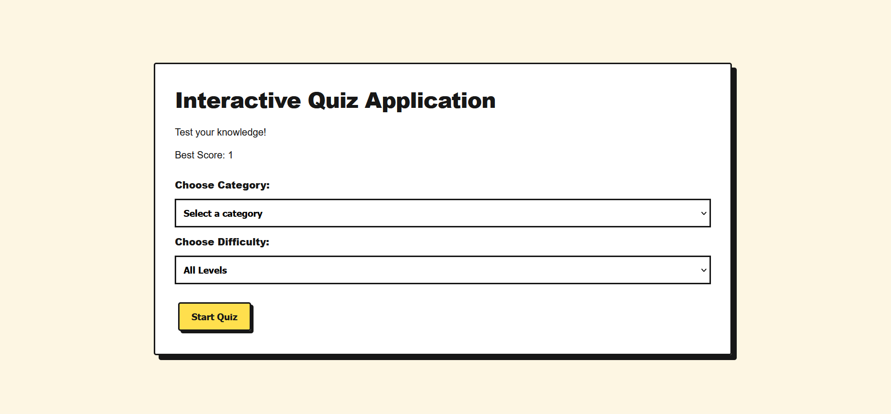

# Interactive Quiz Application

An interactive, browser-based quiz application built using HTML, CSS, and Vanilla JavaScript. Test your knowledge across multiple technical and aptitude categories with difficulty levels, a countdown timer, instant results, and answer review.

## Features

- 10 quiz categories
- 200 multiple-choice questions
- Three difficulty levels: Easy, Medium, and Hard
- Category-based question selection
- Previous and Next question navigation
- Interactive question palette
- 20-minute countdown timer
- Automatic submission when time expires
- Score and percentage calculation
- Correct and incorrect answer review
- Best score tracking using LocalStorage
- Restart quiz and return Home functionality
- Neo-brutalist user interface

## Tech Stack

- **HTML5** – Application structure
- **CSS3** – Styling and responsive interface
- **JavaScript** – Quiz logic and DOM manipulation
- **JSON** – Question bank storage
- **LocalStorage** – Best score persistence

## Live Demo

[Try Interactive Quiz Application](https://faiz9994.github.io/interactive-quiz-app/)

## Screenshots

### Home Screen


### Quiz Screen


## Project Structure

```text
interactive-quiz-app/
│
├── index.html
├── style.css
├── script.js
│
└── questions/
    ├── aptitude.json
    ├── cn.json
    ├── dbms.json
    ├── dsa.json
    ├── html-css.json
    ├── javascript.json
    ├── oop.json
    ├── os.json
    ├── programming.json
    └── react.json
```

## Getting Started

### Run Locally

1. Clone the repository:

   ```bash
   git clone https://github.com/Faiz9994/interactive-quiz-app.git
   ```

2. Open the project folder:

   ```bash
   cd interactive-quiz-app
   ```

3. Open the folder in VS Code.

4. Install the **Live Server** extension if you haven't already.

5. Right-click `index.html` and select **Open with Live Server**.

## How It Works

1. Select a quiz category.
2. Choose your preferred difficulty level.
3. Start the quiz.
4. Navigate between questions using Previous, Next, or the question palette.
5. Submit the quiz or let the timer submit it automatically.
6. Review your score and answers.

## Future Improvements

- Add more questions and categories.
- Add user authentication and leaderboards.
- Store quiz history and performance analytics.
- Introduce a backend for persistent user data.

## Author

**Mohammad Faiz**

GitHub: [Faiz9994](https://github.com/Faiz9994)

---

If you find this project useful, consider giving it a ⭐ on GitHub.